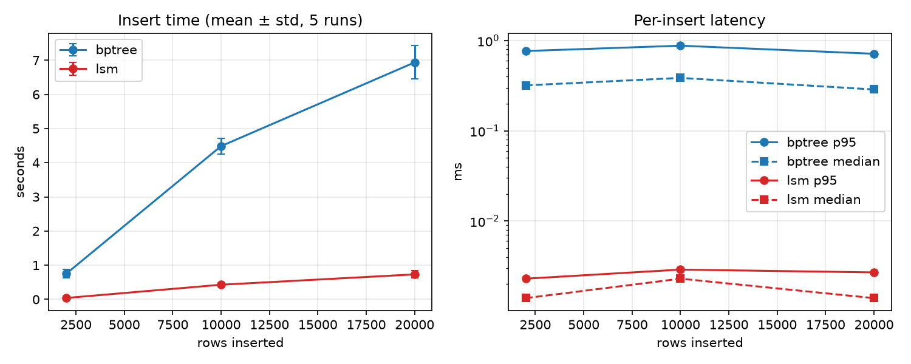
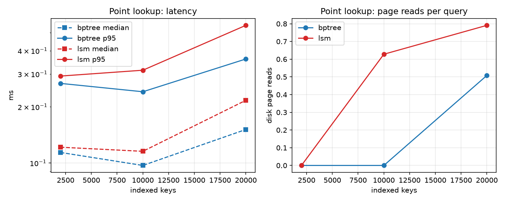
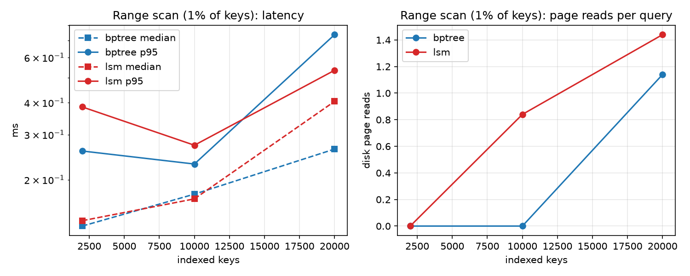
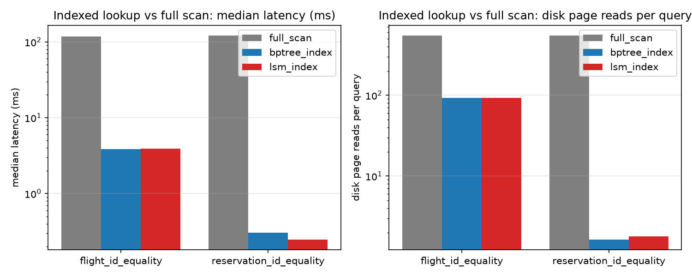
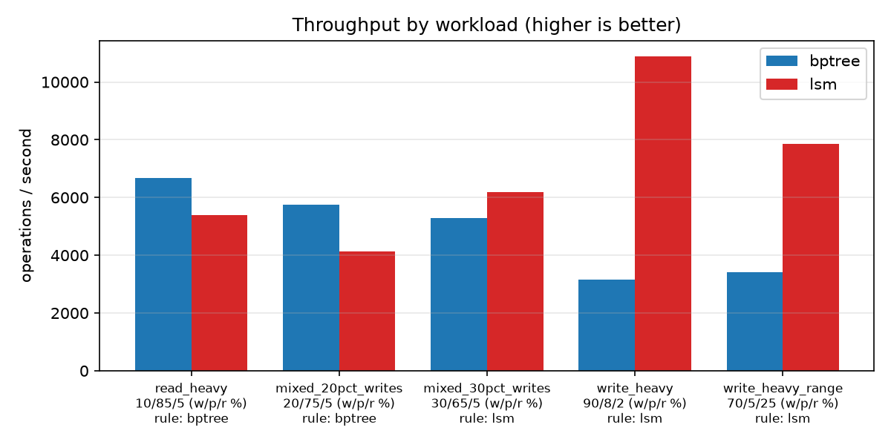

# AeroCore – Milestone 2: Advanced Indexing System

CSAI 302 – Advanced Database Systems, Fall 2026
Branch: `feature/m2-indexing`

## 1. Scope

Milestone 2 adds, on top of the M1 storage engine (4 KB pages, `DiskManager`, `BufferPool`, `RowStore`):

| Requirement | What was built | Code |
|---|---|---|
| B+ Tree index | Disk-based B+ Tree with equality and range lookup, duplicate keys, delete, persistence | `aerocore/index/bptree.py` |
| LSM Tree index | Memtable + immutable sorted runs + compaction, same interface as the B+ Tree | `aerocore/index/lsm.py` |
| Auto-select index based on workload | Documented rule, `create_index(kind="auto")` and `reselect()` | `aerocore/index/selector.py`, `aerocore/index/indexed_table.py` |
| Object storage | Chunked byte-object store on the M1 pages, catalog kept in a B+ Tree | `aerocore/objects/store.py` |
| Encryption hooks | Pluggable `Cipher` interface, `NullCipher`, demo `StreamCipher` | `aerocore/objects/encryption.py` |
| Simple indexed queries | `IndexedTable.find`, `find_range`, kept in sync on insert/update/delete | `aerocore/index/indexed_table.py` |
| SQL-like indexed queries | Tokenizer, parser, execution engine, `EXPLAIN`, SQL shell, end-to-end demo | `aerocore/sql/`, `aerocore/cli.py`, `aerocore/demo_m2.py` |
| Tests and measurements | 76 pytest tests in total (67 for M1+M2 additions) and 6 benchmark experiments | `tests/`, `benchmarks/`, `results/m2/` |

The M1 files received only small additive changes: `BufferPool.new_page()`, `RowStore.scan_with_rids()`, `RowStore.update()` now returns the new RID, and `RowStore.insert()` tries the newest page first instead of scanning every page.

## 2. Design

### 2.1 Index files

Every index is its own file built with the M1 `DiskManager` and `BufferPool`, so index pages are cached, pinned, evicted and counted exactly like table pages. Table files are untouched.

Each index entry is `[key, page_id, slot_id]`. Putting the record ID inside the entry makes every entry unique, so non-unique keys such as `flight_id` in `reservations` need no special handling, and an update that moves a row is simply "delete old entry, insert new entry".

Typed schemas for the six tables are in `aerocore/index/schema.py` (the original `AIRLINE_SCHEMAS` only lists column names). Supported key types are `int`, `str` and `float`; dates are stored as ISO strings (`2026-12-01T08:30`), which sort correctly as text.

### 2.2 B+ Tree

- Page 0 holds metadata (root page, key type, entry count, height). Every other page holds one tree node as a single record in slot 0 of an M1 slotted page.
- Nodes are JSON, like M1 records. A node splits when its serialized size exceeds 3,600 bytes, so the fan-out adapts to the key size.
- Leaves are linked through a `next` pointer for range scans.
- Deletes are lazy (entries are removed, nodes are not merged).

### 2.3 LSM Tree

- Writes go to an in-memory memtable (a dict of `(key, page, slot) → put/delete marker`). When it holds 2,000 entries it is flushed as a new immutable sorted run.
- Each run is its own page file: page 0 is metadata, the other pages each hold one sorted chunk. The first entry of every page is kept in memory as a fence index so a lookup reads only the needed page.
- Reads check the memtable and every run that overlaps the requested key range; a newer entry overrides an older one, and a delete marker hides older inserts.
- When more than 4 runs exist they are merged into one (full compaction) and delete markers are dropped.
- A run is written to a `.tmp` file and renamed, so an interrupted flush never leaves a half-written run.

### 2.4 Workload-based selection rule

```
write_ratio = writes / (writes + point_reads + range_reads)
write_ratio >= 25%  ->  LSM Tree
otherwise           ->  B+ Tree
```

The LSM Tree turns random inserts into memory writes plus sequential run files, so it wins when writes are a meaningful share of the work. Reads pay for this because a lookup may check several runs. The 25% threshold was chosen from the workload benchmark in section 4.5. `IndexedTable.create_index(col, "auto")` applies the rule to an expected workload or to the operations observed so far, and `reselect(col)` rebuilds an index as the other type if the observed workload says so. The rule returns a reason string, for example *"write-heavy: 90% of operations are writes (threshold 25%)"*.

### 2.5 Object storage and encryption hook

- `ObjectStore.put/get/delete/exists/info/list` stores arbitrary byte objects (e-tickets, passenger manifests) under string ids such as `ticket:<reservation_id>` or `manifest:<flight_id>`.
- An object is optionally encrypted, split into 4,000-byte chunks (one record per chunk in an M1 page) and described by a manifest record (size, SHA-256 checksum, cipher name, content type, chunk locations).
- A B+ Tree maps `object_id → manifest RID`, so object lookup reuses the M2 index.
- The encryption hook is any class with `encrypt(bytes)` and `decrypt(bytes)`. `StreamCipher` is a working demonstration built only from the standard library (SHA-256 keystream plus an HMAC-SHA256 tag, encrypt-then-MAC). Tests confirm that plaintext never reaches the file, that a wrong key is rejected and that a flipped byte is detected. It is a teaching cipher, not production security; an audited AEAD (for example AES-GCM) can be plugged in through the same two methods.

### 2.6 SQL-like query layer

`aerocore/sql/parser.py` turns text into a small syntax tree and `aerocore/sql/engine.py` executes it on `IndexedTable`s (one per table, listed in `catalog.json`). Supported statements: `CREATE TABLE`, `CREATE INDEX ... USING auto|bptree|lsm [WORKLOAD (w, p, r)]`, `DROP INDEX`, `REINDEX`, `INSERT`, `SELECT ... WHERE ... ORDER BY ... LIMIT`, `UPDATE`, `DELETE`, `EXPLAIN SELECT` and `SHOW`. Conditions use `=`, `!=`, `<`, `<=`, `>`, `>=`, `BETWEEN` joined by `AND`.

- **Access path.** Equality on an indexed column gives an index lookup; `<`, `<=`, `>`, `>=` or `BETWEEN` on an indexed column gives an index range scan (bounds from several conditions on the same column are merged); otherwise the table is scanned. Every condition is re-checked on each fetched row, so exclusive bounds, `!=` and conditions on other columns are always correct. `EXPLAIN` prints the plan, for example `Filter status = 'confirmed'` over `IndexScan reservations.flight_id using bptree index (key = 12)`.
- **Index selection.** `CREATE INDEX ... USING auto` applies the rule of section 2.4. Without a `WORKLOAD` clause it uses the operations observed so far (every SQL condition is counted as a point or range read, every insert/update/delete as a write), so a freshly bulk-loaded table looks write-heavy; the `WORKLOAD (writes, point_reads, range_reads)` clause states the expected workload explicitly. `REINDEX` rebuilds an index as the other type when the observed workload says so.
- **Safety.** Fixed tokenizer, `?` placeholders for values, one statement per call, no comments, catalog-checked names (see README section 12.5). Values are type-checked against the schema. `INSERT` validates every row (types, primary key present, no duplicate key) before storing any, so a bad row never leaves a partial insert.
- **Baseline for correctness tests.** `execute(sql, use_index=False)` forces a full scan; the tests compare it with the indexed result.
- **Object storage.** `Database.objects` exposes an `ObjectStore` (optionally encrypted) next to the tables; the demo stores a ticket for a reservation.

## 3. Correctness evidence

All 76 tests pass (`python -m pytest -v`). The M2 tests cover:

- **B+ Tree:** equality and range results compared with a Python dict and sorted list on 3,000 shuffled keys with tiny nodes (3+ levels); sequential inserts; duplicate keys; delete; reopen and query; string keys; an index pointing at real `RowStore` rows.
- **LSM Tree:** the same reference comparison with flushes and compactions forced; delete markers overriding older inserts and being dropped by compaction; update as delete-plus-insert; duplicates; persistence; string keys; and a randomized insert/delete workload on which the LSM Tree and the B+ Tree return identical results.
- **IndexedTable:** indexed lookups equal full-scan results and read fewer pages; indexes stay correct after update (RID change) and delete; indexes survive reopening; automatic selection and `reselect`; type validation.
- **Object storage:** round trips from 0 bytes to 200 KB; replace, delete, list by prefix; persistence; 300 objects; encryption round trip with ciphertext on disk; wrong key, wrong cipher and tampering detected.
- **SQL layer (`tests/test_sql.py`):** parsing and parameter binding; 17 hostile or malformed statements rejected (stacked statements, comments, `OR`, `UNION`, double-quoted strings, unterminated strings, ...); injection text stored and queried as plain data; 13 fixed queries and 80 random queries return identical rows with an index and with a forced full scan (B+ Tree and LSM columns, equality, ranges, strict bounds, `!=`, mixed conditions); `UPDATE` and `DELETE` keep both index types correct; uniqueness and all-or-nothing `INSERT`; type and catalog errors; `EXPLAIN` plans; automatic index selection and `REINDEX`; persistence of tables and indexes after reopening; indexed lookups reading fewer table pages than a scan.
- **Shell and helpers (`tests/test_cli.py`):** one-shot `-c` and `--file` execution with exit codes, the interactive prompt, airline table creation and bulk loading. The LSM write counter is covered in `tests/test_lsm.py`.

Every benchmark run also checks its results (`correct` column in the CSVs); all are `True`.

## 4. Performance evaluation

### 4.1 Method

Command: `python -m benchmarks.run_m2 --runs 5 --seed 42` (total 227 s). Machine and configuration are recorded in `results/m2/environment.json`:

| Item | Value |
|---|---|
| OS / CPU / RAM | Windows 11, AMD64 (8 logical CPUs), 13.9 GB |
| Python | 3.15.1, single-threaded |
| Data | Synthetic, fixed seed 42, integer keys 1..n inserted in shuffled order |
| Runs | 1 warm-up run, then 5 measured runs; mean and standard deviation of run time, median and p95 of per-operation latency (pooled over runs) |
| Buffer pools | B+ Tree 64 frames (256 KB); LSM 16 frames per run; table 16 frames; LRU |
| LSM | memtable 2,000 entries, compaction above 4 runs |

All timings are wall-clock (`time.perf_counter`) and include Python overhead; the absolute numbers matter less than the comparisons between structures measured under the same conditions.

### 4.2 Insertion (E1)

| Keys | B+ Tree ops/s | LSM ops/s | LSM faster by | B+ median / p95 (ms) | LSM median / p95 (ms) |
|---:|---:|---:|---:|---:|---:|
| 2,000 | 2,529 | 42,320 | 16.7× | 0.328 / 0.787 | 0.0019 / 0.0026 |
| 10,000 | 3,267 | 24,949 | 7.6× | 0.262 / 0.616 | 0.0022 / 0.0030 |
| 20,000 | 3,220 | 23,414 | 7.3× | 0.268 / 0.609 | 0.0023 / 0.0029 |

At 20,000 keys the total time was 6.21 ± 0.24 s for the B+ Tree and 0.85 ± 0.03 s for the LSM Tree, and the final index size was 508 KB versus 380 KB. The LSM median per-insert latency is tiny because most inserts only touch the memtable; the cost of flushing and compaction is concentrated in a few slow inserts above the p95 (the mean is 0.043 ms per insert, about 18× the median). The B+ Tree pays one leaf-page rewrite per insert.



### 4.3 Point lookups and range scans (E2, E3)

Point lookups, 2,000 random existing keys per run:

| Keys | B+ median / p95 (ms) | LSM median / p95 (ms) | B+ page reads per lookup | LSM page reads per lookup |
|---:|---:|---:|---:|---:|
| 2,000 | 0.106 / 0.275 | 0.108 / 0.182 | 0.00 | 0.00 |
| 10,000 | 0.089 / 0.231 | 0.129 / 0.307 | 0.00 | 0.63 |
| 20,000 | 0.136 / 0.299 | 0.209 / 0.447 | 0.51 | 0.79 |

Range scans, each covering 1% of the keys (50 queries per run):

| Keys | B+ median / p95 (ms) | LSM median / p95 (ms) | B+ page reads | LSM page reads |
|---:|---:|---:|---:|---:|
| 2,000 | 0.239 / 0.502 | 0.111 / 0.198 | 0.00 | 0.00 |
| 10,000 | 0.242 / 0.453 | 0.174 / 0.291 | 0.00 | 0.84 |
| 20,000 | 0.261 / 0.717 | 0.389 / 0.498 | 1.14 | 1.44 |

At 2,000 keys point lookups are equivalent and the LSM Tree is faster for range scans (about 2×, probably because all its data is still in one memtable or run). As the index grows past the buffer pool the picture reverses: at 20,000 keys the B+ Tree is about 1.5× faster for both point lookups and range scans, because it follows one root-to-leaf path and linked leaves while the LSM Tree may have to consult several runs. Note that the B+ Tree page reads are 0 at 2,000 and 10,000 keys because the whole index (40 KB and 252 KB) fits in its 256 KB buffer pool; at 20,000 keys the index (508 KB) no longer fits and page reads appear.




### 4.4 Indexed lookup versus full scan (E4)

Reservations table with 20,000 rows (550 data pages), table buffer pool 16 frames:

| Query | Method | Median (ms) | p95 (ms) | Page reads per query |
|---|---|---:|---:|---:|
| `reservation_id = x` (1 row) | Full scan | 111.2 | 202.0 | 550 |
| | B+ Tree index | 0.318 | 0.801 | 1.63 |
| | LSM index | 0.248 | 0.782 | 1.80 |
| `flight_id = x` (about 100 rows) | Full scan | 144.9 | 218.8 | 550 |
| | B+ Tree index | 3.25 | 6.52 | 92.6 |
| | LSM index | 6.46 | 10.07 | 93.2 |

The index is about 350× faster than a scan for the unique key (B+ Tree) and 22× to 45× faster for the 100-row query. The advantage shrinks as selectivity falls, because each matching row costs a table page fetch: for `flight_id` the index still reads 93 pages per query, and would approach the scan's 550 as the number of matches grows. Latency improves by more than the page-read ratio because a scan also parses every row.



### 4.5 Workload mixes and the selection rule (E5)

10,000 preloaded keys, 2,000 operations per run; a mix is written as writes / point reads / range reads (%):

| Workload | B+ Tree ops/s | LSM ops/s | Faster | Rule picks | Match |
|---|---:|---:|---|---|---|
| read_heavy 10/85/5 | 5,521 | 6,342 | LSM (1.15×, within noise) | B+ Tree | no |
| mixed 20/75/5 | 5,993 | 3,620 | B+ Tree (1.66×) | B+ Tree | yes |
| mixed 30/65/5 | 4,507 | 6,741 | LSM (1.50×) | LSM | yes |
| write_heavy 90/8/2 | 2,717 | 12,101 | LSM (4.5×) | LSM | yes |
| write_heavy_range 70/5/25 | 2,698 | 7,354 | LSM (2.7×) | LSM | yes |

The rule matched the faster structure on 4 of 5 workloads. The one mismatch (10% writes) is a difference of 15% while the run-to-run standard deviation of the LSM time is about 23% of its mean, so it is not a meaningful loss. The three clear regimes agree with the rule: B+ Tree when reads dominate, LSM Tree when writes are 30% or more of the work, even when 25% of the operations are range scans.

The 10–30% write band is a near tie in which the winner changes between runs: a first complete run of the same command produced the B+ Tree as faster at both 10% and 30% writes, while the run reported here produced the LSM Tree at both. The 25% threshold therefore sits in the middle of a noisy band rather than at a sharp boundary, and should be re-measured on the deployment machine.



### 4.6 Building an index over existing rows (E6)

| Structure | Time to index 20,000 rows | Rows/s | Index size |
|---|---:|---:|---:|
| B+ Tree | 6.66 ± 0.46 s | 3,002 | 632 KB |
| LSM Tree | 0.88 ± 0.12 s | 22,734 | 376 KB |

Both include one scan of the 550 table pages. The LSM Tree builds 7.6× faster and is smaller, at the price of slower lookups at larger sizes (section 4.3).

## 5. Discussion

- The results match the expected trade-off: the LSM Tree is much better for writes and index builds, the B+ Tree is better for point and range reads once the data outgrows the cache. The automatic selection rule encodes that trade-off with a threshold taken from measurements.
- Indexes pay off by orders of magnitude for selective queries, and less as selectivity decreases (section 4.4).
- The buffer pool size strongly affects the B+ Tree numbers: while the tree fits in memory there is no I/O at all, so conclusions about page I/O should only be drawn from the largest size.
- The JSON node format keeps the code simple and consistent with M1, but makes every node access pay for JSON parsing, which is why all latencies are in the tens to hundreds of microseconds even without I/O. A binary node layout would be a clear improvement.

## 6. Limitations

- **B+ Tree:** lazy deletes (no node merging, so space is not reclaimed); JSON node encoding; string keys limited to 400 characters; no `fsync`, no crash safety (M4).
- **LSM Tree:** no Bloom filters; no write-ahead log, so entries still in the memtable are lost if the process crashes before a flush or close (M4 adds the WAL); full compaction rather than leveled compaction; `len()` scans the whole index.
- **Benchmark instrumentation:** the LSM Tree counts the page writes of flushes and compactions (`stats()["disk_writes"]`). The CSV files must be regenerated with `python -m benchmarks.run_m2 --runs 5 --seed 42` to show these counts; files produced before this change report 0 writes for the LSM Tree.
- **SQL layer:** no `OR`, joins, aggregates or sub-queries (M3); single-column indexes; the access path is a fixed rule, not cost-based (M3); statements are validated but not transactional (M4); the `Filter` shown by `EXPLAIN` lists only conditions the index does not guarantee, but all conditions are re-checked on every row.
- **Benchmarks:** single thread, one machine, five runs, standard deviation between 7% and 46% of the mean run time on the workload mixes (reported in `results/m2/workload_results.csv`), integer keys inserted in shuffled order, narrow (50-key) ranges in the workload mixes.
- **Object storage:** objects are limited to 1 MB because the manifest must fit in one record; there is no free-page list, so space freed by deletes is not reused except on the last page.
- **Encryption:** `StreamCipher` is a demonstration, not an audited cipher.
- **ColumnStore** is not indexable (it has no record IDs and does not persist its page mapping), which is an M1 limitation.

## 7. Reproducing the results

```bash
pip install -r requirements.txt
python -m pytest -v                                   # 76 tests
python -m aerocore.demo_m2                            # SQL + indexes + encrypted ticket + restart
python -m aerocore.cli                                # interactive SQL shell
python -m benchmarks.run_m2 --runs 5 --seed 42        # about 2-4 minutes
python data/generate_airline.py --table reservations --rows 100000 --seed 42   # optional dataset
```

Outputs are written to `results/m2/`: `insert_results.csv`, `lookup_results.csv`, `range_results.csv`, `scan_vs_index_results.csv`, `workload_results.csv`, `build_results.csv`, five comparison charts and `environment.json`. Use `--quick` for a short smoke test (not for reporting).

## 8. Rubric map

| Criterion | Marks | Evidence |
|---|---:|---|
| B+ Tree: equality and range lookup, connected to the storage engine | 5 | `bptree.py`, `tests/test_bptree.py`, sections 4.2–4.4 |
| LSM Tree: write-oriented index implemented and tested | 4 | `lsm.py`, `tests/test_lsm.py`, sections 4.2, 4.5 |
| Workload-based choice: documented rule | 2 | `selector.py`, section 2.4, section 4.5 |
| Object storage path and encryption extension point | 1 | `aerocore/objects/`, `tests/test_objects.py`, section 2.5 |
| Indexed lookup compared with full scan under read/write workloads | 3 | sections 4.4, 4.5, `results/m2/` |
| Deliverable: simple SQL-like indexed queries | (all) | section 2.6, `aerocore/sql/`, `tests/test_sql.py`, `python -m aerocore.demo_m2` |